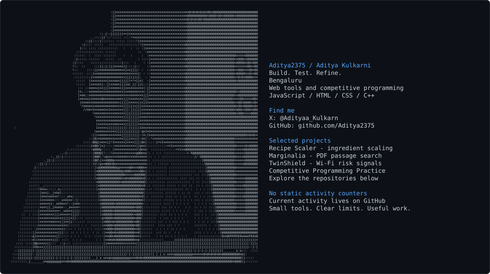

# Hi, I'm Aditya 👋

CS & AI student at Scaler School of Technology, Bengaluru (BITS Pilani dual-degree). I build small web tools and do competitive programming.

Lately: a recipe scaler that placed 6th at ZeroCode, Techfest - IIT Bombay's Chennai zonal ([try it here](https://aditya2375.github.io/recipe-scaler/)). Also [Marginalia](https://marginalia-eta-eight.vercel.app), a browser-based PDF passage search tool, and [TwinShield](https://github.com/Aditya2375/twinshield), a Wi-Fi risk-signal demo, not a security guarantee. Browse [practice solutions](https://github.com/Aditya2375/Competitive_Programming_Practice) and [all repositories](https://github.com/Aditya2375?tab=repositories).

Find me on [LinkedIn](https://www.linkedin.com/in/adityaaakulkarni/) and [X](https://x.com/Adityaa_Kulkarn).

## License

Licensed under either of [MIT](LICENSE-MIT) or [Apache License 2.0](LICENSE-APACHE) at your option.
